<div align="center">


<br />

[](https://github.com/DeamonDev888/swarm-control/actions/workflows/ci.yml)
[](https://crates.io/crates/swarm-control)
[](https://docs.rs/swarm-control)
[](https://github.com/DeamonDev888/litemcp)
[](https://www.rust-lang.org)
[](#léger-mesuré)
[](LICENSE-MIT)

<br />

**Des agents IA qui se souviennent, tournent en continu et se parlent entre eux.**
Un seul exécutable de 2 Mio, rien d'autre à installer — propulsé par [LiteMCP](https://github.com/DeamonDev888/litemcp).

[Installer](#1-installer) · [Premiers pas](#2-premiers-pas) · [Un agent = un exécutable](#3-un-agent--un-exécutable) · [Commandes](#commandes) · [Outils MCP](#les-10-outils-mcp) · [Dépannage](#dépannage) · [Architecture](docs/ARCHITECTURE.md)

</div>

---

## C'est quoi ?

Quand vous lancez `claude -p "…"` ou `hermes chat`, l'IA **oublie tout** dès que la commande se termine.
`swarm-control` transforme ces outils en **agents** :

| | Sans swarm-control | Avec swarm-control |
|---|---|---|
| Mémoire | perdue à chaque appel | l'agent **reprend sa conversation** à chaque fois |
| Plusieurs IA | à lancer à la main, une par une | jusqu'à **10 agents en parallèle**, suivis et arrêtables |
| Toujours en ligne | non | un agent peut rester **résident 24/7** (Discord, WhatsApp, X, Google…) |
| Piloter depuis une IA | non | Claude Code peut **créer et commander** d'autres agents |

Il fonctionne avec les outils d'IA en ligne de commande que vous avez déjà :
**Claude Code** (`claude`), **Hermes** (`hermes`) et **Antigravity** (`agy`). D'autres arrivent (opencode, Kilo, Cline, OpenClaw…).

<div align="center">
  
</div>

### Les mots à connaître

| Mot | En clair |
|---|---|
| **Agent** | Une IA avec un nom (`architecte`, `sniper`…), une personnalité (son *prompt*) et une mémoire. |
| **Runner** | Le programme d'IA qui fait réellement le travail : `claude`, `hermes` ou `agy`. |
| **Session** | La conversation de l'agent, sauvegardée sur disque et reprise à chaque appel. |
| **Agent résident** | Un agent qui reste allumé et répond aux demandes au fil de l'eau, comme un bot. |
| **MCP** | Le protocole standard qui permet à une IA (Claude Code, Cursor…) d'utiliser des outils. `swarm-control` est un serveur MCP, construit sur [LiteMCP](https://github.com/DeamonDev888/litemcp). |
| **Workspace** | Le dossier où tout est rangé (agents, sessions, journaux). Par défaut : `~/.swarm-control`. |

---

## 1. Installer

### Le plus simple : l'exécutable tout prêt

**Windows** — dans PowerShell :

```powershell
irm https://raw.githubusercontent.com/DeamonDev888/swarm-control/main/install.ps1 | iex
```

**Linux / macOS** — dans un terminal :

```bash
curl -fsSL https://raw.githubusercontent.com/DeamonDev888/swarm-control/main/install.sh | sh
```

Le script télécharge la dernière version, la place dans votre dossier utilisateur
(`%LOCALAPPDATA%\Programs\swarm-control` ou `~/.local/bin`) et l'ajoute au `PATH`.
**Aucun droit administrateur**, aucune dépendance. Relancez la même commande pour mettre à jour.

<details>
<summary><b>Je préfère télécharger le fichier à la main</b></summary>

Prenez le fichier de votre système sur la [page des releases](https://github.com/DeamonDev888/swarm-control/releases/latest) :

| Système | Fichier |
|---|---|
| Windows 64 bits | [`swarm-control-windows-x86_64.exe`](https://github.com/DeamonDev888/swarm-control/releases/latest/download/swarm-control-windows-x86_64.exe) |
| Linux x86_64 | [`swarm-control-linux-x86_64`](https://github.com/DeamonDev888/swarm-control/releases/latest/download/swarm-control-linux-x86_64) |
| Linux ARM (Raspberry Pi, VPS ARM) | [`swarm-control-linux-aarch64`](https://github.com/DeamonDev888/swarm-control/releases/latest/download/swarm-control-linux-aarch64) |
| macOS Apple Silicon (M1, M2…) | [`swarm-control-macos-aarch64`](https://github.com/DeamonDev888/swarm-control/releases/latest/download/swarm-control-macos-aarch64) |
| macOS Intel | [`swarm-control-macos-x86_64`](https://github.com/DeamonDev888/swarm-control/releases/latest/download/swarm-control-macos-x86_64) |

Puis renommez-le `swarm-control` (`swarm-control.exe` sous Windows) et, sous Linux/macOS, rendez-le exécutable :

```bash
chmod +x swarm-control
./swarm-control --version
```

Chaque version publie aussi des archives `.zip` / `.tar.gz` avec leur somme SHA-256.
</details>

<details>
<summary><b>Avec Rust (cargo)</b></summary>

```bash
cargo install swarm-control
```
</details>

### Vérifier que tout est prêt

```bash
swarm-control --version
swarm-control doctor
```

`doctor` passe tout en revue et affiche `✓` ou `✗` pour chaque point : le workspace, les droits d'écriture,
et **quels runners sont installés** (`claude`, `hermes`, `agy`). Il vous en faut **au moins un**.

> Pas encore de runner ? Installez par exemple [Claude Code](https://docs.claude.com/fr/docs/claude-code) puis relancez `swarm-control doctor`.

---

## 2. Premiers pas

### Étape 1 — Démarrer le serveur

```bash
swarm-control
```

Il affiche son adresse, par exemple `http://127.0.0.1:23080/mcp`. Laissez cette fenêtre ouverte.
(Le port est le premier libre entre 23080 et 23099 ; `--port 23085` pour en imposer un.)

### Étape 2 — Le brancher à Claude Code (ou tout client MCP)

```bash
claude mcp add --transport http swarm http://127.0.0.1:23080/mcp
```

Autres clients (Cursor, Claude Desktop, …) : ajoutez ceci à leur configuration MCP :

```json
{ "mcpServers": { "swarm": { "type": "http", "url": "http://127.0.0.1:23080/mcp" } } }
```

### Étape 3 — Parler à vos agents

Dans Claude Code, demandez simplement en français :

> *« Crée un agent `architecte` avec le runner claude, c'est un architecte logiciel. Puis demande-lui un plan d'API. »*

Claude utilisera tout seul les outils de `swarm-control` :

```text
create_agent(name:"architecte", runner:"claude", prompt:"Tu es un architecte logiciel…")
run_agent(runner:"claude", agentName:"architecte", prompt:"Propose un plan d'API")   ← session créée
run_agent(runner:"claude", agentName:"architecte", prompt:"Détaille l'étape 2")      ← il se souvient
```

Vous pouvez aussi tout faire **depuis le terminal**, sans client MCP :

```bash
swarm-control agents                                  # liste vos agents
swarm-control run architecte "Détaille l'étape 3"      # un tour, avec sa mémoire
swarm-control runs                                    # ce qui tourne / a tourné
```

---

## 3. Un agent = un exécutable

C'est la façon la plus simple de faire vivre un agent : **copiez l'exécutable sous le nom de l'agent**.
Lancé ainsi, il ne sert que cet agent.

```bash
# Windows
copy swarm-control.exe sniper.exe
# Linux / macOS
cp swarm-control sniper
```

Ensuite :

```bash
sniper                         # ouvre une interface terminal pour discuter avec l'agent
sniper ask "état du marché ?"  # pose une question et affiche la réponse
sniper status                  # occupé ? libre ? combien de demandes en attente ?
sniper history                 # ses derniers échanges
sniper reset                   # oublie la conversation : repart à zéro
```

> Pas envie de renommer ? `swarm-control --agent sniper` fait exactement la même chose.
> Depuis Claude Code, `create_agent(…, executable:true)` crée cette copie pour vous dans `<workspace>/bin/`.

### L'interface terminal

| Touche | Action |
|---|---|
| Tapez + `Entrée` | envoie le message à l'agent |
| `Échap` | efface le message en cours |
| `↑` `↓` `PgUp` `PgDn` / molette | fait défiler la conversation · `Fin` revient en bas |
| `r` | oublie la session (nouvelle conversation) |
| `s` | arrête la réponse en cours |
| `d` | affiche / masque le panneau debug |
| `q` | quitte l'interface (l'agent continue) · `Ctrl-C` quitte **et** arrête l'agent |

Les raccourcis à une lettre ne marchent que quand le champ de message est vide.

### Agent permanent (serveur, bot Discord…)

<div align="center">
  
</div>

```bash
sniper --headless --bridge 3001
```

- `--headless` : pas d'interface, l'agent attend les demandes (idéal en service ou sur un VPS).
- `--bridge 3001` : ouvre un petit pont HTTP pour un bot externe (compatible avec le worker Discord `overmind-bridge`) :

| Route | Rôle |
|---|---|
| `POST /send` | `{message, userId, username, channelId}` → réponse de l'agent `{result, session_id}` |
| `POST /reset` | oublie la session |
| `GET /status` · `GET /health` | état de l'agent · sonde de vie |

Sous Linux, `create_agent(…, executable:true, unit:true)` écrit en plus un service systemd prêt à l'emploi
(`<workspace>/bridge/units/swarm-<agent>.service`). Il n'est **jamais activé tout seul** : l'outil vous rend la
commande `sudo systemctl enable --now …` à lancer quand vous êtes prêt.

---

## Commandes

```text
swarm-control [COMMANDE] [OPTIONS]        swarm-control --help pour le détail
```

| Commande | À quoi ça sert |
|---|---|
| *(aucune)* ou `serve` | démarre le serveur MCP (ou l'agent seul, en mode agent) |
| `doctor` | diagnostic de l'installation : ✓ / ✗ |
| `agents` | liste les agents et où ils tournent |
| `run <agent> "<texte>"` | un tour pour un agent nommé |
| `runs` | dernier run de chaque agent (statut, PID, fin) |
| `ask "<texte>"` | pose une question à l'agent (`--agent NAME` ou exécutable renommé) |
| `status` | état de l'agent |
| `history [-n N]` | derniers échanges de l'agent |
| `reset` | oublie la session de l'agent |
| `config [--file NOM]` | fichiers de configuration de l'agent (secrets masqués) |
| `schema <outil>` | format attendu par un outil MCP |

Options utiles : `--workspace DIR` (autre dossier de travail), `--port N`, `--resident alice,bob` (démarre des
agents résidents avec le serveur), `--model M`, `--json` (sortie brute pour les scripts), `--debug` (journal détaillé).

---

## Les 10 outils MCP

Ce sont les outils que votre client MCP (Claude Code…) voit quand il est branché sur `swarm-control`.

| Outil | Rôle |
|---|---|
| `create_agent` | Crée un agent : nom, runner, personnalité, modèle, serveurs MCP. Options : `resident:true` (l'allume aussitôt), `executable:true` (sa copie d'exécutable), `unit:true` (service systemd, Linux), `cloneFrom` (Hermes : réutilise les clés d'un profil). |
| `run_agent` | Fait travailler un agent. Avec `agentName` : il reprend sa conversation. Sans : agent **jetable**, un seul tour. `background:true` rend la main tout de suite avec un `runId`. |
| `run_agents_parallel` | Jusqu'à 10 agents en même temps, runners mélangés. |
| `agent_control` | Suivre un run : `status`, `stream` (sortie en direct), `wait`, `kill`, `list`. |
| `agent_start` / `agent_stop` | Allume / éteint un agent **résident**. |
| `list_agents` | Tous les agents, leur session, leur run en cours, leur adresse s'ils sont résidents. |
| `get_agent_configs` | Fichiers d'un agent, **secrets masqués**. |
| `update_agent_config` | Change modèle, serveurs MCP, variables, prompt. |
| `delete_agent` | Supprime l'agent, sa session et son exécutable dédié (refusé s'il est en train de travailler). |

Chaque outil publie un JSON Schema : les arguments invalides sont refusés avec la liste des problèmes.

---

## Agents résidents

Un agent **résident** reste allumé : il a son propre petit serveur MCP (`swarm-<agent>`), une **file d'attente**
et traite les demandes une par une, toujours dans la même conversation.

```text
agent_start(name:"alice")
→ {"agent":"alice","url":"http://127.0.0.1:23082/mcp", …}
```

Son serveur expose : `ask` (poser une question), `status`, `stop`, ainsi que `history`, `logs`, `config` et `session`
pour l'inspecter.

Bon à savoir :

- **Un agent n'est allumé qu'à un seul endroit**, même avec plusieurs `swarm-control` ouverts : un deuxième `agent_start` est refusé et indique où il tourne déjà.
- Si vous appelez `run_agent` sur un agent résident, la demande est **transmise automatiquement** là où il tourne.
- Les agents peuvent **s'appeler entre eux** (`ask`) ; les boucles (A → B → A) sont détectées et refusées.
- Plusieurs serveurs sur la même machine ? Chacun prend un numéro (`swarm-control-1`, `-2`…, ou `--instance N`).

Guide détaillé : [docs/RESIDENT-AGENTS.md](docs/RESIDENT-AGENTS.md).

---

## Configuration

Tout est optionnel. Les variables peuvent aussi être mises dans un fichier `.env` du workspace.

| Variable | Rôle |
|---|---|
| `SWARM_WORKSPACE` | dossier de travail (sinon `--workspace`, sinon `~/.swarm-control`) |
| `SWARM_TIMEOUT_MS` | durée maximale d'un run (défaut : 15 min) |
| `SWARM_TOKEN` | jeton exigé par les serveurs MCP (`Authorization: Bearer …`) — **obligatoire** pour écouter ailleurs qu'en local |
| `SWARM_DEBUG=1` | journal détaillé, comme `--debug` |
| `SWARM_CLAUDE_PERMISSIONS` | permissions passées à Claude (défaut `--dangerously-skip-permissions`) |
| `CLAUDE_BIN`, `HERMES_BIN`, `AGY_BIN` | chemin des runners s'ils ne sont pas dans le `PATH` |
| `HERMES_HOME` | dossier des profils Hermes |

Alias de modèles : `<workspace>/model-aliases.json` → `{"rapide": "claude-haiku-5-5"}`.
Les anciennes variables `OVERMIND_*` restent lues.

### Sécurité — à lire

- Par défaut, le serveur n'écoute **qu'en local** (`127.0.0.1`) : personne d'autre ne peut s'y connecter.
- Les agents tournent **sans demande de permission** (`--dangerously-skip-permissions`) : ils peuvent lire, écrire et exécuter dans leur dossier. Donnez-leur des tâches en conséquence.
- Pour écouter sur le réseau (`--host 0.0.0.0`), un `SWARM_TOKEN` est **exigé** : sans lui, le démarrage est refusé.
- Aucun secret n'est écrit dans les fichiers passés à Claude ; les jetons passent par l'environnement.

---

## Dépannage

<details>
<summary><b>« swarm-control » n'est pas reconnu / command not found</b></summary>

Ouvrez un **nouveau** terminal (le `PATH` n'est relu qu'au démarrage). Sous Linux/macOS, vérifiez que
`~/.local/bin` est dans votre `PATH` (le script d'installation vous l'indique sinon).
</details>

<details>
<summary><b>Windows affiche « Windows a protégé votre ordinateur » (SmartScreen)</b></summary>

L'exécutable n'est pas signé. Cliquez sur **Informations complémentaires → Exécuter quand même**,
ou installez avec le script PowerShell, qui débloque le fichier.
</details>

<details>
<summary><b>macOS refuse d'ouvrir le fichier</b></summary>

Si vous l'avez téléchargé avec un navigateur : `xattr -d com.apple.quarantine ./swarm-control`.
Le script `install.sh` n'a pas ce problème.
</details>

<details>
<summary><b>doctor dit que <code>claude</code> / <code>hermes</code> / <code>agy</code> est introuvable</b></summary>

Le runner n'est pas installé, ou pas dans le `PATH`. Installez-le, ou indiquez son chemin :
`CLAUDE_BIN`, `HERMES_BIN`, `AGY_BIN`.
</details>

<details>
<summary><b>Un agent Hermes neuf ne répond pas (erreur de clé)</b></summary>

Un nouveau profil Hermes n'hérite pas de vos clés API. Créez-le avec `cloneFrom:"<profil qui marche>"`
pour copier sa config, son `.env` et ses skills.
</details>

<details>
<summary><b>Erreur <code>AGENT_BUSY</code></b></summary>

L'agent est déjà en train de travailler (deux réponses en même temps abîmeraient sa conversation).
Attendez la fin, ou arrêtez le run : `agent_control(action:"kill", …)`. Les agents résidents, eux, mettent les
demandes en file d'attente.
</details>

<details>
<summary><b>Le port est déjà pris</b></summary>

`swarm-control` essaie 23080 à 23099 tout seul. Pour en choisir un : `swarm-control --port 24000`.
</details>

Toujours bloqué ? `swarm-control --debug …` affiche tout ce qui se passe, et `swarm-control doctor` résume l'état.

---

## Pour aller plus loin

<details>
<summary><b>Comment un agent garde sa mémoire</b></summary>

1. **Sa définition est sur disque** : un prompt (personnalité) et une config, dans son dossier `<workspace>/agents/<nom>/` (Hermes : ses profils natifs).
2. **Sa session est reprise** : l'identifiant de session est rangé dans `bridge/state/<runner>-<agent>.json` (30 jours) et repassé au runner (`--resume`) à chaque tour. Si la session a disparu, l'agent repart à neuf, une seule fois.
3. **Un seul run à la fois par agent**, même entre plusieurs serveurs : un bail sur disque (`bridge/owners/`) l'empêche de répondre deux fois en parallèle (`AGENT_BUSY`).
4. **Secours** : jetons de repli Claude sur 401 / 429 / 5xx.
5. **Historique** : chaque tour est journalisé dans `bridge/history/` (fichiers JSONL tournants).

Les agents créés avec l'ancien OverMind TS (`.claude/`, profils Hermes, `bridge/agents.json`) fonctionnent tels quels.
</details>

<details>
<summary><b>Utiliser swarm-control comme bibliothèque Rust</b></summary>

```toml
[dependencies]
swarm-control = { version = "0.1", default-features = false }   # sans l'interface terminal
```

```rust
fn main() -> std::process::ExitCode {
    swarm_control::serve_agent("sniper")   // un binaire dédié à l'agent « sniper »
}
```

Documentation : [docs.rs/swarm-control](https://docs.rs/swarm-control).
</details>

### Léger (mesuré)

Build `--release`, Windows 11, mémoire = *working set* du process :

| | |
|---|---|
| Binaire | **≈ 2 Mio** |
| Mémoire au repos | **≈ 7 Mio**, 5 threads |
| 24 agents résidents au repos | **≈ 7 Mio** au total : **≈ 80 Kio et 2 threads par agent** |
| Dépendances directes | [`litemcp`](https://crates.io/crates/litemcp), `serde`, `serde_json` (+ `ratatui` pour l'interface) — aucun runtime async |

### Construit sur LiteMCP

Le serveur MCP, la validation des arguments (JSON Schema) et l'annonce des agents résidents viennent de
[**LiteMCP**](https://github.com/DeamonDev888/litemcp) ([crates.io](https://crates.io/crates/litemcp) · [docs.rs](https://docs.rs/litemcp)),
une bibliothèque Rust MCP légère et synchrone (Streamable HTTP, spec `2026-07-28`). Sa latence est mesurée dans son dépôt.

<details>
<summary><b>Face aux autres projets</b></summary>

Recherche GitHub du 2026-11-26, non exhaustive, d'après la description publique de chaque projet.

| Projet | Forme | Notre angle |
|---|---|---|
| [agent-of-empires](https://github.com/agent-of-empires/agent-of-empires) | plusieurs agents Claude Code / OpenCode depuis une TUI ou le web | un **serveur MCP** : un agent pilote d'autres agents comme un outil |
| [cas](https://github.com/codingagentsystem/cas) | orchestration multi-agent pour Claude Code, mémoire, tâches | le cœur seul (persistance + orchestration), sans base de données |
| [hcom](https://github.com/aannoo/hcom), [amux](https://github.com/mixpeek/amux) | agents qui se parlent / plan de contrôle | sessions reprises par agent nommé, runs suivis et tuables |
| [cersei](https://github.com/pacifio/cersei), [swarms-rs](https://github.com/The-Swarm-Corporation/swarms-rs) | frameworks Rust pour *écrire* des agents | on **orchestre des CLI existants** |
| [Puppetmaster](https://github.com/professorpalmer/Puppetmaster) | plan de contrôle Python, état durable | Rust, MCP natif, quelques Mio |
</details>

## Feuille de route

Déjà là : Claude Code, Hermes et Antigravity · sessions persistantes · agents résidents · un exécutable par agent ·
pont HTTP · CLI complète et interface terminal · historique · découverte des pairs · jeton d'authentification.

À venir :

- **Pairs injectés automatiquement** : chaque agent verra les autres agents résidents comme des outils, sans configuration.
- **Plus de runners** : opencode, Kilo, Cline, OpenClaw, grokbot, puis n'importe quel CLI décrit sans recompiler.

## Contribuer

```bash
bash scripts/verify.sh      # fmt · clippy · tests · doc · paquet · cargo-deny
cargo test                  # tests unitaires et de bout en bout
```

Organisation du code : [docs/ARCHITECTURE.md](docs/ARCHITECTURE.md) · Publier une version : [docs/RELEASE.md](docs/RELEASE.md) · Historique : [CHANGELOG.md](CHANGELOG.md).

## Licence

MIT ou Apache-2.0, au choix.

<div align="center">
  <br />
  
</div>
