<div align="center">



<br />

[](https://github.com/DeamonDev888/swarm-control/actions/workflows/ci.yml)
[](https://crates.io/crates/swarm-control)
[](https://docs.rs/swarm-control)
[](https://www.rust-lang.org)
[](#léger-mesuré)
[](LICENSE-MIT)

<br />

**Instancie des agents IA persistants via LiteMCP, en Rust.**

Chaque agent créé = **1 profil et 1 exécutable** — il vit, se souvient et communique avec ses pairs.
Compatible **Hermes** (natif), **Claude Code**, **Antigravity**, **grokbot**, **opencode**, **Kilo / Cline**, **OpenClaw**,
et extensible à tout runner CLI.

> **Statut 0.1.0** — disponible : Hermes et Claude Code, sessions persistantes, orchestration, **agents résidents** (serveur MCP propre, file de demandes, `ask`), 10 outils MCP, un binaire de 2 Mio.
> En construction : un exécutable par agent, les pairs qui se retrouvent et s'appellent tout seuls, les autres runners — voir la [feuille de route](#feuille-de-route).

[Démarrage](#démarrage-rapide) · [Outils](#les-10-outils) · [Résidents](#agents-résidents) · [Persistance](#comment-un-agent-reste-persistant) · [Légèreté](#léger-mesuré) · [Concurrence](#face-à-la-concurrence) · [Feuille de route](#feuille-de-route) · [Architecture](docs/ARCHITECTURE.md) · [Publication](docs/RELEASE.md)

</div>

---

## Pourquoi

Lancer `claude -p` ou `hermes chat` à la main perd tout entre deux appels. `swarm-control` en fait des **agents** :

- **Persistants** — un agent nommé reprend sa dernière session (`--resume`) à chaque appel et sauvegarde la nouvelle. Si la session a disparu, elle est oubliée et l'agent repart à neuf, une seule fois.
- **Orchestrés** — jusqu'à 10 agents en parallèle, runs en arrière-plan, statut, sortie en direct, `wait`, `kill` de l'arbre de processus, balayage des orphelins.
- **MCP natif** — c'est un serveur MCP (Streamable HTTP sans état, spec `2026-07-28`, via [LiteMCP](https://crates.io/crates/litemcp)). Un agent peut donc en piloter d'autres : Claude Code appelle `run_agent` comme n'importe quel outil.
- **Typé** — chaque outil publie un **JSON Schema** (DSL à la Zod de LiteMCP) ; les arguments sont validés avant d'atteindre le handler (`-32602` avec la liste des problèmes).

## Archétypes d'agents

Exemples de spécialisations que tu peux créer avec `create_agent` et orchestrer en parallèle via `run_agents_parallel` :

<div align="center">
  
</div>

### Agents persistants uniquement (Discord, WhatsApp, X, Google & Custom)

Conçus pour tourner en **agents résidents durables** (`1 profil = 1 exécutable`, session conservée 24/7 d'un message à l'autre) : au-delà des connecteurs **Discord** (`--bridge` HTTP & MCP), **WhatsApp**, **X** et **Google (Gmail & Calendar)**, **les agents customisables n'attendent que des bridges CLI et des serveurs MCP à être connectés** (Telegram, Slack, Matrix, webhooks, outils internes…) pour habiter n'importe quel canal.

<div align="center">
  
</div>

## Démarrage rapide

```bash
cargo install swarm-control          # ou : cargo run --release
swarm-control --workspace ~/.swarm-control
# swarm-control 0.1.0 — MCP sur http://127.0.0.1:23080/mcp  (workspace: …)
```

Port : premier libre de `23080..=23099`, ou `--port N`. Prérequis : le CLI `claude` et/ou `hermes` installé.

Côté client MCP :

```json
{ "mcpServers": { "swarm": { "type": "http", "url": "http://127.0.0.1:23080/mcp" } } }
```

Puis, depuis le client :

```text
create_agent(name:"architecte", runner:"claude", prompt:"Tu es un architecte logiciel…")
run_agent(runner:"claude", agentName:"architecte", prompt:"Propose un plan d'API")   # session créée
run_agent(runner:"claude", agentName:"architecte", prompt:"Détaille l'étape 2")      # session reprise
run_agent(runner:"claude", prompt:"Question ponctuelle")   # agent ÉPHÉMÈRE : un tour, rien de sauvegardé
```

## Les 10 outils

| Outil | Rôle |
|---|---|
| `run_agent` | Lance un agent. Avec `agentName` : reprise de session automatique. **Sans `agentName` : agent éphémère** — un tour, aucune session gardée. `background:true` rend un `runId`. |
| `run_agents_parallel` | Jusqu'à 10 agents en parallèle, runners mélangeables ; `waitAll:false` rend la main au premier succès. |
| `agent_control` | `status` · `stream` (sortie en direct) · `wait` · `kill` · `list`. |
| `agent_start` | Rend un agent **résident** : serveur MCP propre (`swarm-<agent>`), file de demandes, fil de travail. Rend son URL. |
| `agent_stop` | Arrête un agent résident : tour tué, file vidée, serveur fermé, annonce retirée. |
| `create_agent` | Claude : prompt + settings + MCP. Hermes : profil natif + `SOUL.md` (`cloneFrom` pour réutiliser les clés d'un profil). `resident:true` l'héberge aussitôt. `executable:true` copie le binaire courant en `<workspace>/bin/<agent>` ; `unit:true` (Linux) écrit en plus une unit systemd `--headless`, non activée. |
| `list_agents` | Agents Claude et Hermes, état de session, run en cours, et l'URL de leur hôte s'ils sont résidents. |
| `get_agent_configs` | Fichiers d'un agent, **secrets masqués**. |
| `update_agent_config` | Modèle, serveurs MCP, variables, prompt — ou réécriture d'un fichier. |
| `delete_agent` | Supprime l'agent et sa session, plus son exécutable et son unité dédiés s'ils existent ; refusé s'il tourne. |

## Agents résidents

Un agent **résident** est chargé en mémoire dans le process : il a son **propre serveur MCP**, annoncé dans le registre de LiteMCP sous `swarm-<agent>`, une **file de demandes** et **un fil de travail** qui les sert une par une, toujours sur la même session.

```text
agent_start(name:"alice")
→ {"agent":"alice","name":"swarm-alice","url":"http://127.0.0.1:23082/mcp","instance":"swarm-control-1"}
```

Le serveur d'`alice` expose trois outils :

| Outil | Rôle |
|---|---|
| `ask` | `{prompt, from?, via?, timeoutMs?, model?}` — met la demande dans la file, rend `{reply, sessionId, queuedMs, durationMs, via}`. Un **cycle** entre pairs (`via` contenant déjà l'agent) est refusé. |
| `status` | idle / busy, longueur de la file, tour en cours (qui demande, depuis quand), session, dernier tour. |
| `stop` | tue le tour en cours ; `clearQueue:true` annule aussi les demandes en attente. L'agent reste résident. |

- **Un seul hôte par agent**, même entre plusieurs instances : un bail d'hébergement (`bridge/hosts/`) porte l'URL ; un second `agent_start` est refusé en disant où l'agent se trouve.
- **Rien d'autre en RAM** que la file et l'état du tour : la conversation reste dans la session du CLI, relancé une fois par tour. Mesure : voir [Léger](#léger-mesuré).
- Démarrage direct : `swarm-control --resident alice,bob`.
- **Instances numérotées** : chaque `swarm-control` prend le premier numéro libre (`swarm-control-1`, `-2`…, ou `--instance N`), s'annonce sous ce nom et le porte comme hôte de ses agents. Un numéro pris est refusé.
- **Routage** : `run_agent` / `run_agents_parallel` d'un agent résident sont **transmis à son hôte** (`ask`, quelle que soit l'instance qui reçoit l'appel) ; la réponse porte `routedTo`. Reste **local, à la demande** : agent sans hôte, hôte injoignable, `background:true`, ou run qui impose `sessionId`, `path`, `provider` ou `autoResume:false`.

## Un exécutable par agent

Copiez le binaire sous le nom d'un agent : lancé ainsi, il ne sert **que cet agent** (son serveur MCP `swarm-<agent>`, sa file, sa session), sans serveur d'administration.

```bash
cp swarm-control sniper            # Windows : copy swarm-control.exe sniper.exe
./sniper --port 23090 --bridge 3001 --workspace ~/.swarm-control
# swarm-sniper 0.2.0 — MCP sur http://127.0.0.1:23090/mcp  (agent: sniper, runner: hermes, …) · pont HTTP sur http://127.0.0.1:3001
```

- `--agent NAME` fait la même chose sans renommer (pratique dans une unit systemd) ; depuis un crate à vous : `fn main() -> ExitCode { swarm_control::serve_agent("sniper") }`.
- **`--bridge N`** ouvre un pont HTTP compatible avec l'`overmind-bridge` Node (worker Discord) : un routeur existant n'a qu'à changer de port.

| Route | Rôle |
|---|---|
| `POST /send` | `{message, userId, username, channelId}` → l'agent reçoit le bloc `[DISCORD CONTEXT]` habituel → `{result, session_id}` (`result` vide si l'agent a déjà posté sur Discord via MCP) |
| `POST /reset` | oublie la session : le prochain message repart à neuf (sûr même pendant un tour) |
| `GET /status` · `GET /health` | état de l'agent · sonde de vie |

### L'exécutable et l'unité créés par `create_agent`

`create_agent(…, executable:true)` copie le binaire courant (`std::env::current_exe`) dans `<workspace>/bin/<agent>` (`.exe` sous Windows) et rend son chemin dans la réponse. Chaque agent reçoit **sa propre copie**, nommée d'après lui : un fichier `bin/<agent>` n'est référencé que par cet agent, donc `delete_agent` le retire sans vérification de références croisées — il ne peut pas y en avoir. Plusieurs agents peuvent partager *le même binaire d'origine* (leurs copies proviennent du même exécutable), jamais le même fichier.

`create_agent(…, executable:true, unit:true)` écrit en plus une unit systemd `<workspace>/bridge/units/swarm-<agent>.service` — `ExecStart=<chemin> --headless --workspace <ws>`, redémarrage sur échec — **écrite, jamais activée** : rien n'est installé en `/etc`, rien ne démarre au boot tant que vous n'avez pas exécuté le `installHint` renvoyé par l'outil (`sudo cp … /etc/systemd/system/ && sudo systemctl enable --now swarm-<agent>`). Option **Linux uniquement** : ailleurs elle est refusée avec une erreur claire (« non supporté ici ») qui dit ce qui a quand même été créé (l'agent et sa copie du binaire restent en place).

## Comment un agent reste persistant

1. **Définition sur disque** : un prompt (persona) + une config, créés une fois.
2. **Session reprise** : la session de l'agent est dans **son** fichier d'état (`bridge/state/<runner>-<agent>.json`, 30 jours) ; chaque run la repasse à `--resume`. L'ancien `bridge/agents.json` de l'OverMind TS reste lu en repli.
3. **Registre de processus** : PID, statut et sortie en mémoire ; PID et statut du dernier run dans le même fichier d'état, pour le retrouver après redémarrage ou depuis une autre instance.
4. **Un seul run vivant par agent — même entre plusieurs instances** : chaque run détient un **bail** sur disque (`bridge/owners/`, créé de façon exclusive, renouvelé toutes les 30 s, repris s'il est périmé). Deux reprises simultanées corrompraient la session : la seconde est refusée (`AGENT_BUSY`), qu'elle vienne du même process ou d'un autre `swarm-control` sur le même workspace.
5. **Secours** : jetons de repli Claude sur 401 / 429 / 5xx ; session périmée → relance à neuf.

Les définitions d'un agent vivent dans **son dossier de profil** `<workspace>/agents/<nom>/` (Claude : `.claude/…` ; Antigravity : `.antigravity/…` ; Hermes : ses profils natifs, déjà individuels) au lieu du workspace partagé. Les agents créés avant restent lus, modifiables et supprimables à leur ancien emplacement : un constructeur de chemin vise le profil dédié dès qu'il existe, sinon l'emplacement historique tant qu'il existe, sinon le profil dédié (créations). `list_agents`, `run_agent`, `update_agent_config` et `delete_agent` suivent automatiquement.

Les agents Claude (`.claude/`) et Hermes (profils) sont ceux de l'ancien OverMind TS : vos agents existants fonctionnent tels quels, et leurs sessions déjà enregistrées dans `bridge/agents.json` sont reprises.

## Léger (mesuré)

Build `--release`, Windows 11, mémoire = *working set* du process (une exécution ; les piles de threads réservées mais non touchées n'y figurent pas) :

| | |
|---|---|
| Binaire | **1,93 Mio** |
| Mémoire au repos | **≈ 7 Mio** (7,3 Mio après 200 appels), 5 threads |
| 24 agents résidents, au repos | **≈ 7 Mio** au total (5,1 Mio sans agent) : **≈ 80 Kio et 2 threads par agent** |
| …après une demande à chacun | ≈ 9 Mio, 78 threads (le client garde une connexion ouverte par agent) |
| Dépendances directes | `litemcp`, `serde`, `serde_json` — aucun runtime async |

La latence de LiteMCP lui-même est documentée dans [son dépôt](https://github.com/DeamonDev888/litemcp).

## Face à la concurrence

Recherche GitHub du 2026-11-26, non exhaustive. La colonne « Forme » reprend la **description publique** de chaque projet ; je n'ai pas audité leur code.

| Projet | Forme (d'après sa description) | Notre angle |
|---|---|---|
| [agent-of-empires](https://github.com/agent-of-empires/agent-of-empires) | gère plusieurs agents Claude Code / OpenCode depuis une TUI ou le web | un **serveur MCP** : un agent pilote d'autres agents comme un outil |
| [cas](https://github.com/codingagentsystem/cas) | orchestration multi-agent pour Claude Code, avec mémoire, tâches, règles | le cœur seul (persistance + orchestration), sans base de données |
| [hcom](https://github.com/aannoo/hcom), [amux](https://github.com/mixpeek/amux) | agents qui se parlent / plan de contrôle avec tableau de tâches | sessions reprises par agent nommé, runs suivis et tuables |
| [cersei](https://github.com/pacifio/cersei), [swarms-rs](https://github.com/The-Swarm-Corporation/swarms-rs) | SDK / framework Rust pour *écrire* des agents | on **orchestre des CLI existants** (Claude Code, Hermes) |
| [Puppetmaster](https://github.com/professorpalmer/Puppetmaster) | plan de contrôle Python, état durable | Rust, MCP natif, quelques Mio |

Le créneau visé : **serveur MCP natif + agents persistants + orchestration**, sans base de données ni runtime async.

## Configuration

| Variable | Rôle |
|---|---|
| `SWARM_WORKSPACE` | racine (`.claude/`, `.mcp.json`, `bridge/`) — sinon `--workspace`, sinon `~/.swarm-control` (ou `~/.overmind` s'il existe) |
| `SWARM_TIMEOUT_MS` | délai d'un run (défaut 15 min ; un agent Claude peut surcharger via `AGENT_TIMEOUT_MS` dans son `env`) |
| `SWARM_CLAUDE_PERMISSIONS` | défaut `--dangerously-skip-permissions` |
| `CLAUDE_BIN`, `HERMES_BIN`, `HERMES_HOME` | emplacement des CLI et du home Hermes |

Les anciennes variables `OVERMIND_*` sont toujours lues. Alias de modèles : `<workspace>/model-aliases.json` (`{"surnom": "vrai-modèle"}`).

## Points d'attention

- **Credentials Hermes par profil** : un profil neuf n'hérite pas de vos clés. `create_agent` avertit ; `cloneFrom:<profil>` copie config, `.env`, `SOUL.md` et skills d'un profil qui marche.
- **Aucun secret sur disque** : le fichier de settings passé à Claude ne contient pas `env` ; jetons et variables passent par l'environnement du process.
- **MCP isolés** : un agent Claude reçoit `--strict-mcp-config` avec *seulement* ses serveurs.
- **Sécurité** : le serveur écoute en `127.0.0.1` sans authentification et lance les agents en `--dangerously-skip-permissions`. **Ne pas l'exposer au réseau** (LiteMCP offre la signature de requêtes et TLS si besoin).

## Développement

```bash
bash scripts/verify.sh      # fmt · clippy -D warnings · tests · doc · paquet · cargo-deny
cargo test                  # tests unitaires + de bout en bout (faux CLI : multi-instance, agents résidents, file…)
```

Le code est découpé en petits fichiers classés par couche : voir [docs/ARCHITECTURE.md](docs/ARCHITECTURE.md). Publier une version : [docs/RELEASE.md](docs/RELEASE.md).

## Feuille de route

> À venir — **pas encore implémenté**. Aujourd'hui, Hermes, Claude Code et Antigravity sont pilotés. Déjà fait : les [agents résidents](#agents-résidents) (serveur MCP propre, file, `ask`, annonce), leur exclusivité entre instances, les **instances numérotées** (`swarm-control-N`), le **routage** de `run_agent` vers l'hôte de l'agent, [**un exécutable par agent**](#un-exécutable-par-agent) avec son pont HTTP, et le [dossier de profil par agent](#comment-un-agent-reste-persistant) (`executable`/`unit` de `create_agent` compris).

- **Des pairs qui se trouvent tout seuls** : les `swarm-*` du registre de LiteMCP sont découverts et injectés dans la configuration MCP de chaque agent, dont le modèle les appelle comme des outils (`ask` existe déjà, ainsi que le refus des cycles ; l'injection reste à faire).
- **Plus de runners** : Antigravity, opencode, Kilo, Cline, OpenClaw (grokbot : dès que sa commande est connue), puis tout CLI décrit sans recompiler.
- **CLI complète** : sous-commandes (`serve`, `agents`, `run`, `runs`, `doctor`…), introduction en ASCII, affichage de tout ce que fait le serveur.
- **Mode debug** : traces des requêtes MCP, des commandes lancées, des sessions reprises et des retentes.
- **JSON Schema** : déjà publié par outil ; à exposer aussi en ligne de commande (`schema <outil>`).

## Licence

MIT OU Apache-2.0, au choix.

<div align="center">
  <br />
  
</div>
